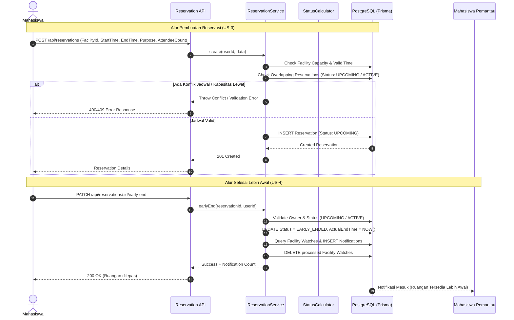

# Dokumen Arsitektur – KelasKosong MVP

Dokumen ini menjelaskan arsitektur sistem, diagram komponen, keputusan desain utama, dan trade-off yang diambil dalam pengembangan backend MVP **KelasKosong**.

---

## 1. Diagram Arsitektur

### 1.1 Diagram Tingkat Tinggi (High-Level System Diagram)

```mermaid
graph TD
    subgraph Clients["Clients"]
        Mobile["Aplikasi Mobile (React Native / Expo)"]
        WebClient["Web Client / API Consumer (cURL / Postman)"]
    end

    subgraph API["Backend API (Node.js + Express + TypeScript)"]
        Router["Express Routing Layer"]
        AuthMid["JWT Auth Middleware"]
        Controller["Controller Layer (Req/Res Validation)"]
        Service["Service Layer (Business Logic & Rules)"]
        StatusCalc["Pure Logic: Status Calculator"]
        Utils["Utilities (JWT, Password Hashing)"]
    end

    subgraph Data["Persistence Layer"]
        Prisma["Prisma ORM"]
        Postgres[("PostgreSQL Database")]
    end

    Mobile -->|HTTP / REST (JSON)| Router
    WebClient -->|HTTP / REST (JSON)| Router

    Router --> AuthMid
    AuthMid --> Controller
    Controller --> Service
    Service --> StatusCalc
    Service --> Utils
    Service --> Prisma
    Prisma --> Postgres
```

### 1.2 Alur Data Reservasi & Early End (Flow Diagram)



---

## 2. Keputusan Desain Utama (Key Design Decisions)

### 2.1 Arsitektur Berlapis (Layered Architecture: Route - Controller - Service - Data)
- **Alasan**: Memisahkan concerns secara tegas:
  - **Routes**: Menangani routing dan middleware proteksi (`authMiddleware`, `requireRole`).
  - **Controllers**: Mengisolasi parsing input HTTP, kode status respon, dan standarisasi output JSON.
  - **Services**: Menyimpan seluruh *domain rules* dan logika bisnis (validasi kuota, overlap slot waktu, hak kepemilikan).
  - **Prisma**: Abstraksi data layer dengan type-safety menyeluruh.
- **Dampak Positif**: Mempermudah pembuatan automated unit test pada Service layer dan utilitas murni tanpa perlu terhubung ke database langsung.

### 2.2 Kalkulasi Status Ketersediaan Dinamis On-the-Fly (`statusCalculator.ts`)
- **Alasan**: Status ketersediaan ruangan (`TERSEDIA`, `AKAN_TERSEDIA`, `SEDANG_DIGUNAKAN`) dihitung secara fungsional (pure function) berdasarkan perbandingan waktu server saat ini (`new Date()`) terhadap jadwal reservasi aktif di database.
- **Keunggulan**:
  - Menghilangkan *state desynchronization* yang rentan terjadi jika status disimpan statis di tabel fasilitas.
  - Tidak memerlukan cron job detik-ke-detik yang membebani resource server hanya untuk memperbarui string status.
  - Sangat mudah diuji (*deterministic unit testing*) dengan menyuplai waktu `currentTime` simulasi.

### 2.3 Mekanisme Anti Double-Booking pada Database Query
- **Alasan**: Bentrok reservasi dicegah secara langsung pada logika service query dengan operator interval waktu Prisma:
  - Reservasi bertabrakan jika `StartTime < newEndTime` dan `EndTime > newStartTime`, dengan status aktif (`UPCOMING` atau `ACTIVE`).
- **Dampak**: Mencegah celah pemesanan ganda di slot waktu yang sama.

### 2.4 Sistem Pantau Fasilitas (Facility Watcher & Notification)
- **Alasan**: Menghubungkan fitur *Early End* (US-4) dengan kebutuhan pengguna lain yang menunggu ruangan kosong.
- **Implementasi**: Mahasiswa dapat mendaftarkan diri (`POST /api/notifications/watch`). Ketika pengguna aktif memicu `early-end`, sistem secara transaksional mengirim notifikasi ke semua watcher yang aktif dan membersihkan antrean watch agar tidak terjadi spam.

### 2.5 Stateless Authentication Menggunakan JWT
- **Alasan**: Menghindari beban session store di server, cocok untuk integrasi mobile apps (React Native) dan kemudahan scaling backend di masa mendatang.

---

## 3. Trade-Off yang Diambil (Architectural Trade-offs)

| Dimensi | Pilihan yang Diambil | Alternatif yang Dipertimbangkan | Justifikasi & Konsekuensi |
|---|---|---|---|
| **Perhitungan Status Ruangan** | On-the-fly via `calculateFacilityStatus()` | Cron worker / Status kolom di DB | **Trade-off:** Sedikit komputasi CPU saat fetch daftar fasilitas, namun menjamin 100% konsistensi data secara real-time tanpa delay cron ataupun beban lock database. |
| **Pembaruan Real-Time** | REST polling & on-demand query | WebSockets / Server-Sent Events (SSE) | **Trade-off:** Latensi pembaruan bergantung pada refresh client, namun jauh lebih sederhana dan stabil untuk tahap MVP, memangkas kompleksitas koneksi socket yang idle di jaringan mobile. |
| **Notifikasi Early End** | In-app DB notification table | Push Notification pihak ketiga (FCM / Expo Push) | **Trade-off:** Notifikasi dibaca saat aplikasi dibuka/di-polling (`GET /api/notifications`), namun tidak membutuhkan setup kredensial cloud eksternal dan API keys di tahap kuliah/lokal. |
| **Mock Testing Strategy** | Unit testing fungsional & mock Prisma client | Integration testing dengan database fisik SQLite/Postgres test | **Trade-off:** Test tidak memverifikasi integritas foreign key fisik Postgres, namun eksekusi test runner sangat cepat (< 5 detik), tidak membutuhkan dependensi eksternal saat CI/CD, dan menguji 100% *business logic branches*. |
